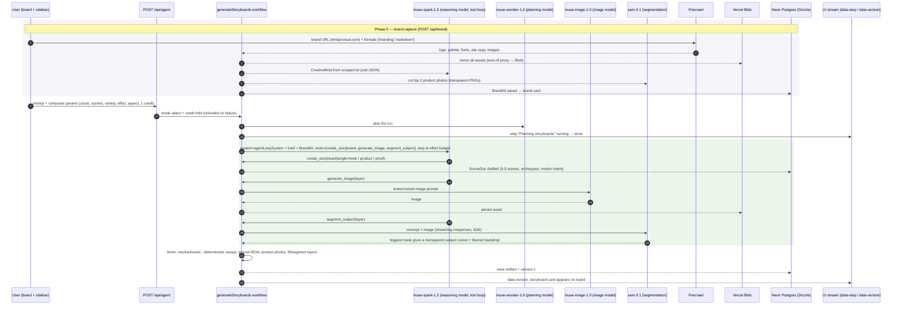
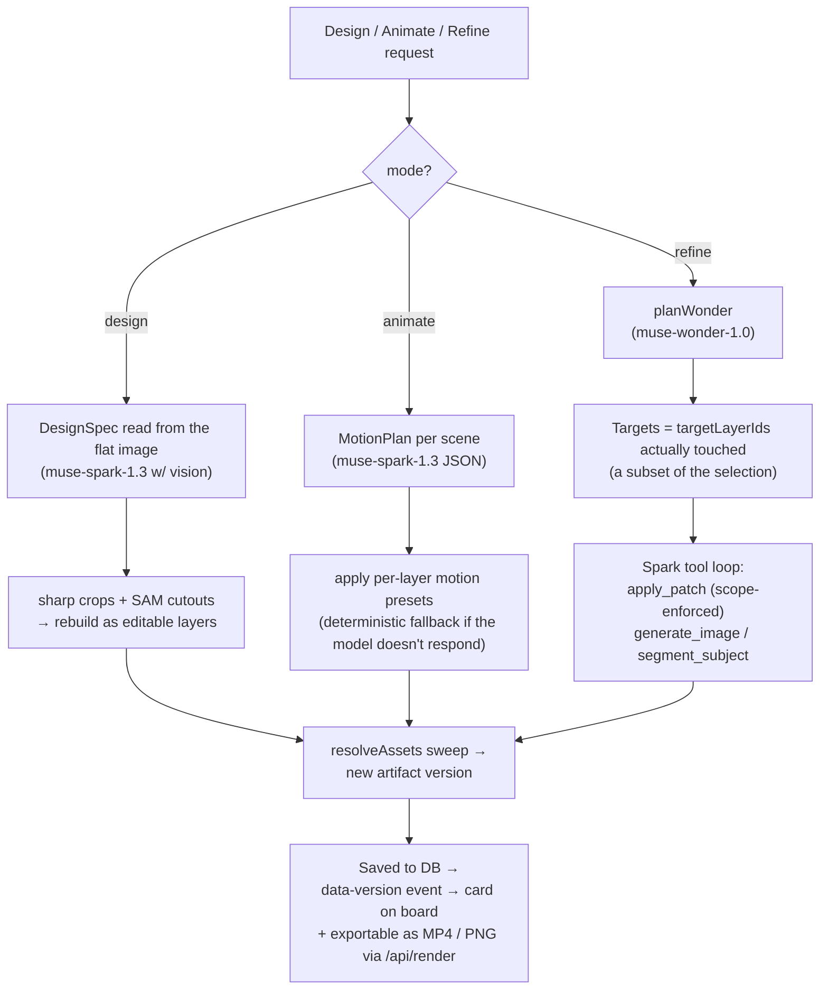

# phantasma

phantasma turns a prompt and a brand URL into editable, brand-consistent motion graphics: titles, callouts, and short animated videos. Generate storyboard variants on a board, select layers, refine them in plain language, and export MP4 (9:16 and 16:9) and PNG.

## Stack

- Next.js on Vercel (App Router, TypeScript)
- Neon Postgres with Drizzle ORM
- Vercel Blob for storage
- Better Auth
- Remotion + Remotion Lambda for video rendering
- Vercel AI SDK with Meta Model API (OpenAI-compatible)

## Getting started

```bash
npm install
cp .env.example .env.local # fill in your keys
npm run dev
```

## Setup

1. Sign in with your account.
2. Add your brand URL and a prompt on the board.
3. Pick a storyboard variant, refine layers, and export your video.

---

# How the agent works

Everything below happens in one short walk: **you paste a brand URL (e.g. `https://whisprcloud.com`), you type a prompt ("launch promo for WhisprCloud, 9:16"), you press run — and storyboards land on the board as editable, versioned cards.**

## Phase 0 — Brand capture (`POST /api/brand` → `lib/brand/firecrawl.ts`)

Before any generation, the brand URL is turned into a **BrandKit**: name, logo, palette, fonts, real product photos, and a machine-written creative brief.

1. **Firecrawl** scrapes the site with `formats: ['branding', 'markdown']` in one call — returns logo, color palette, typography, site copy (markdown), and `og:` metadata.
2. **Deterministic extraction** (no extra LLM calls): the brand name comes from `og:site_name`, the tagline from `og:description`, "voice" headlines are plucked from the markdown's own headings, and site images are classified (`product` / `lifestyle` / `screenshot`) by alt-text and URL heuristics, ranked so hero packshots win.
3. **Mirroring**: every kept asset is re-hosted into **Vercel Blob** through the `wsrv.nl` image proxy, so the board never depends on a site's geo-blocked CDN. The logo and top product shots land in the kit.
4. **Product understanding** (`lib/brand/brief.ts`): the reasoning model **muse-spark-1.3** reads the scraped kit + site copy and writes a structured **CreativeBrief** (zod-validated, one self-correcting retry): `whatItIs` paragraph, audience, benefits (from the site's own words, never invented), dramatizable *moments*, concrete `visualElements` to draw, settings, UI elements, tone, and an `avoid` list. Prompts and generators consume this from here on.
5. **SAM cutouts**: the top 2 product photos are cut with SAM so the kit carries transparent PNGs the way a designer's brand folder does. Fails silently — the plain photo stays.

The kit is saved to the database and shown as the **brand card** on the board.

## Phase 1 — The agent run (`POST /api/agent` → `lib/agent/workflow.ts`)

One run costs one credit (pulled up front, refunded on failure). The endpoint streams every step to the browser as typed data parts (`data-step`, `data-version`) over the AI SDK UI protocol — each step flips from *running* → *done* in place, and each saved version pops up as a card the moment it exists.

Five modes share one route: `generate`, `image`, `refine`, `design`, `animate`.

### Generate mode (storyboards) — a Spark tool loop

1. **Plan**: the planning model **muse-wonder-1.0** turns the prompt into 3–6 human-readable build steps, streamed into the chat as the first progress line.
2. **Loop**: the reasoning model **muse-spark-1.3** drives a **tool loop** (Vercel AI SDK `generateText` with `createOpenAICompatible` talking to the Meta Model API). The system prompt, the brief (with composer params: scenes, variety `close/balanced/wide`, aspect `9:16/16:9/…`, effort), and the full BrandKit go in; three tools come out:
   - **`create_storyboard`** — called once per narrative angle (`hook`, `product`, `proof`). It authors the whole storyboard as a **SceneDoc** JSON (3–5 scenes, scene archetypes like `hook / ui-demo / feature / data / proof / product-hero / end-card`, per-layer transforms, styles, brand-palette backgrounds) — zod-validated, normalized against the brand palette.
   - **`generate_image`** — one call per empty image layer. The image generation model **muse-image-1.0** draws it from a brand-locked prompt (palette, fonts, product understanding); the result is persisted to Vercel Blob.
   - **`segment_subject`** — SAM cuts the subject out of a generated image on layers the storyboard flagged.
   The loop stops at the effort budget (`low 24 / medium 40 / high 56` steps).
3. **Deterministic sweep** (`finish` → `resolveAssets`): whatever the loop left undone gets finished without the LLM — product-hero layers are **grounded in the brand's REAL product photos/cutouts** from the site (only settings/scenes are generated), any remaining empty layer gets an image, flagged layers get their SAM cut. Finally the doc is schema-re-parsed, saved as **artifact version 1**, and the `data-version` event puts the card on the board.



### Image mode — a flat, art-directed poster (Hera-style)

For `mode: 'image'`. If the kit carries real product photos: an **empty advertising set** is generated with muse-image-1.0 and the brand's **real product cutouts** are layered on top of it along with headline and logo layers — one editable layered poster. Without product photos, one full-poster generation is used as a single image layer.

### Design mode — "make every scene editable"

Reads each scene's **flat picture** and rebuilds it as editable layers:

- muse-spark-1.3 (with the actual image, JSON mode) returns a **DesignSpec**: background, and up to 16 elements (text / logo / picture / shape / callout) with boxes as % of the source image, exact copy, style, per-element motion intent, and confidence.
- `sharp` crops regions; SAM cuts out picture and logo elements (logo mark, product).
- The result is a new artifact whose every headline line, label, and logo is a separate layer the user can move and refine — preserving scene durations.

### Animate mode — one film per storyboard

Per scene, muse-spark-1.3 plans motion from a deterministic preset vocabulary (`reveal`, `slide-up`, `slide-left`, `pop`, `float`, `ken-burns`, `type`, `count-up`) with per-layer delays/durations, constrained to entrance + ambient motion only (copy and product stay in place). Falls back to the deterministic `fallbackMotion()` choreographer if the model doesn't answer. Multi-scene storyboards keep the per-scene durations the agent authored; a single scene takes the user's duration.

### Refine mode — scoped, versioned patching

1. muse-wonder-1.0 reads the change request against the **selected layers** and returns the plan + the target layers actually affected (a subset of the selection; nothing outside it).
2. muse-spark-1.3 drives another tool loop where **enforcement of scope is structural**: `apply_patch` is the only thing that can edit the document, and it cannot touch layers outside scope. Same image/SAM tools are gated per-layer, so the agent updates only the user's chosen layers.
3. The deterministic sweep + save produce **version N+1** with a revertable history — every change is a version the user can move back to.



## Phase 2 — Export

`POST /api/render` ships the doc to **Remotion Lambda** (`renderMediaOnLambda`, `SceneDoc` composition) for an MP4, or `renderStillOnLambda` for a PNG download.

## Models and services — one table of what they do

| Model / service | What it is | What it does here |
|---|---|---|
| **muse-wonder-1.0** | Planning model | Plans generate/refine runs as human-readable steps; picks the target layers in scope on refine |
| **muse-spark-1.3** | Reasoning model | The **loop driver** (traces each variant through the tool set, thinking before every call): authors SceneDocs, patch ops, per-scene motion plans, CreativeBrief, DesignSpec; tool-calling verified live over the AI SDK OpenAI-compatible provider |
| **muse-image-1.0** | Image model | Generates scene visuals, full posters, and empty ad sets from brand-locked prompts |
| **sam-3.1** | Segmentation | Streaming `/responses` (SSE) segmentation masks; the largest mask becomes a transparent subject cutout + blurred backdrop |
| **Firecrawl** | Scrape | Single-call `['branding','markdown']` returns logo, palette, fonts, site copy, images |
| **wsrv.nl image proxy** | Image proxy | Re-hosts brand assets through Blob so the board never depends on a site's CDN |
| **Vercel AI SDK** | Orchestration | `generateText` + tools + `createUIMessageStream` (agent ↔ form ↔ UI), zod tool schemas and stop conditions |
| **Neon Postgres + Drizzle** | Persistence | Brands, artifacts, versions, credits; in-memory store when unset so the app still runs |
| **Vercel Blob** | Storage | Mirrored brand assets, generated visuals, SAM cutouts |
| **Remotion + Remotion Lambda** | Rendering | SceneDoc → MP4 (h264) and PNG; deploy via `npm run deploy:remotion` |
| **Better Auth** | Auth | Sign-in gates every endpoint; one credit per run |

## Design principles

- **One facade (`lib/meta`)** for all model calls — always JSON-zod with one self-correcting retry; without `META_API_BASE_URL`/`META_API_KEY` the same calls return **deterministic mocks**, so the full pipeline runs end-to-end without keys.
- **Deterministic fallbacks everywhere**: model can't answer → choreographer, seeded mock, or heuristic takeover.
- **Scope enforcement at the tool boundary**: the refine loop structurally cannot touch layers outside the user's selection — refinement is *scoped*, not a suggestion.
- **Grounding over generation**: the product's real photos, cutouts, palette, fonts, and site copy (voice) travel through every scene; visuals that could advertise any other product count as wrong.
- **Everything is a version**: initial draft, refine, design, animate → each produces a version the user can revert to.
- **Streaming honesty**: every step is a live event (`running → done`, with detail) so a run costing tens of seconds reads like work in progress — steps stream as typed UI-data parts.

## Code map

| Path | Purpose |
|---|---|
| `app/api/brand/route.ts` | Brand-capture endpoint (URL → BrandKit) |
| `lib/brand/firecrawl.ts` | Firecrawl scrape, heuristics, mirroring, SAM cutouts |
| `lib/brand/brief.ts` | Creative brief (LLM + deterministic fallback) |
| `app/api/agent/route.ts` | The single agent endpoint; credit + streaming |
| `lib/agent/workflow.ts` | All five agent modes as streamed async generators |
| `lib/agent/tools.ts` | The tool sets each loop can use (strict, scope-enforced) |
| `lib/agent/assets.ts` | Deterministic asset sweep (grounding + fill) |
| `lib/meta/` | The one facade and all model interactions (config / prompts / segment / mocks) |
| `lib/design/decompose.ts` | Flat-image → editable-layers decomposition |
| `lib/scenedoc.ts` | The SceneDoc schema (normalized) that gates every agent attempt |
| `remotion/` | Renderer root (`SceneDocVideo.tsx`, motion presets) |
| `lib/render/lambda.ts` | Remotion Lambda render triggers |
| `lib/db/` | Store abstraction (Drizzle + in-memory) |
